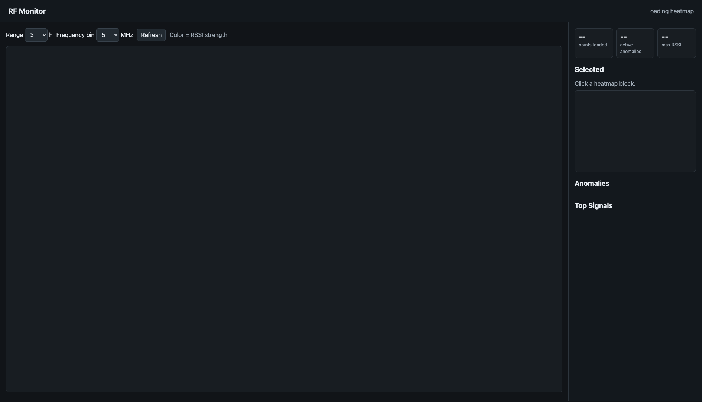
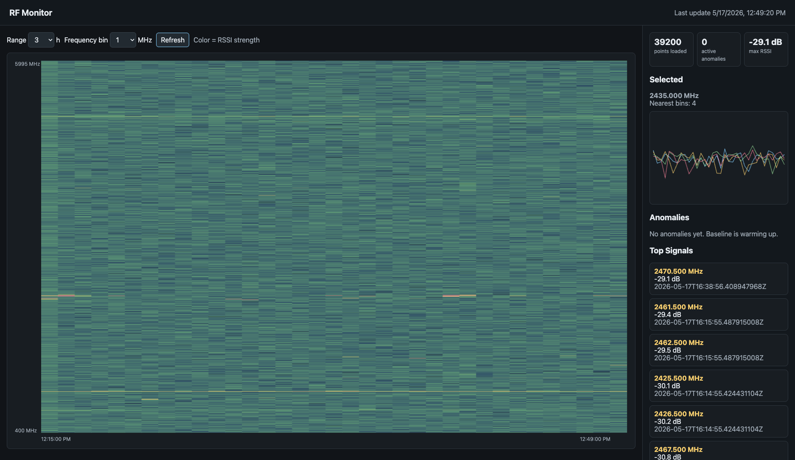
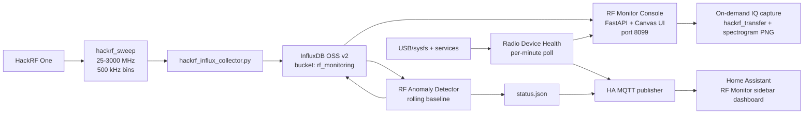
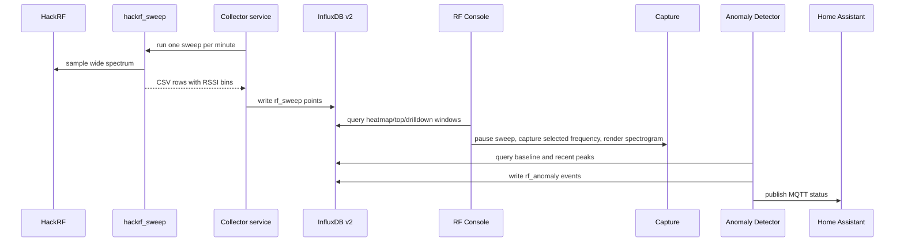

# LinuxGR RF Monitor

HackRF-based RF monitoring for `linuxGR`: sweep the local RF environment, store one RSSI point per frequency bin in InfluxDB, render a browser-based spectrum heatmap, and publish health/anomaly status into Home Assistant.

This repo is the working implementation for a home RF baseline/anomaly project. It is designed to answer:

- What RF energy is present across a wide frequency range right now?
- What changed compared with the recent baseline?
- Which frequency/time block should I drill into next?
- How can Home Assistant alert me without becoming the main RF analysis UI?





## Current Architecture



## Data Flow



## Components

### Collector

`hackrf-monitor/hackrf_influx_collector.py`

Runs `hackrf_sweep`, parses each CSV row, and writes InfluxDB line protocol. The important parser behavior is that bin count comes from the actual RSSI values in each `hackrf_sweep` row, not from the whole requested sweep span.

Example service config:

- `hackrf-monitor/hackrf-influx.service`
- `hackrf-monitor/hackrf-influx.env.example`

### RF Console

`rf-monitor/rf_monitor_console.py`

FastAPI app on port `8099`.

Main endpoints:

- `/` - browser UI
- `/api/heatmap` - frequency/time heatmap matrix
- `/api/frequency/{frequency_hz}` - neighboring-bin drilldown
- `/api/top` - strongest recent bins
- `/api/anomalies` - current anomaly list
- `/api/capture` - on-demand HackRF IQ capture for a selected frequency
- `/api/captures` - recent capture records and generated artifacts
- `/api/health` - Influx/service health

The console can capture a selected signal from the sidebar. A capture briefly pauses `hackrf-influx`, runs `hackrf_transfer`, stores raw unsigned 8-bit interleaved I/Q samples, generates a spectrogram PNG, then resumes the wideband sweep. The first deployed capture mode is intentionally conservative: short IQ captures with metadata and visual inspection before demodulation or classification.

Capture artifacts live on linuxGR under:

```text
/home/cmilkosk/rf-monitor/captures
```

Each capture produces:

- `{capture_id}.iq` - raw HackRF I/Q samples
- `{capture_id}.json` - frequency, sample rate, gain, command output, and analysis metadata
- `{capture_id}.png` - quick-look spectrogram

### Anomaly Detector

`rf-monitor/rf_anomaly_detector.py`

Runs once per minute. It computes a rolling median baseline per frequency and compares the recent peak against that baseline.

Default thresholds:

- Baseline window: `6h`
- Recent window: `3m`
- Minimum rise above baseline: `18 dB`
- Minimum RSSI: `-55 dB`

Anomaly events are written back to InfluxDB as `rf_anomaly`, and the latest status is written to `/home/cmilkosk/rf-monitor/status.json`.

### Home Assistant Publisher

`rf-monitor/publish_rf_ha_status.py`

Publishes MQTT discovery and status sensors for Home Assistant. HA is intentionally a status/alert surface, while the dedicated RF console remains the primary analysis UI.

## Installed Services On linuxGR

The live deployment uses:

```text
influxdb
hackrf-influx
rf-monitor-console
rf-anomaly-detector
rf-signal-scout
rf-ha-status.timer
```

Useful checks:

```bash
systemctl status influxdb hackrf-influx rf-monitor-console rf-anomaly-detector
systemctl list-timers rf-ha-status.timer
journalctl -u hackrf-influx -f
journalctl -u rf-anomaly-detector -f
curl http://127.0.0.1:8099/api/health
```

## InfluxDB Model

InfluxDB OSS v2 is used deliberately. This repo expects the v2 bucket/org/token API, not InfluxDB v1 databases or InfluxDB 3 Core.

Primary bucket:

```text
org: home
bucket: rf_monitoring
retention: 30d
```

Measurements:

- `rf_sweep`
- `rf_anomaly`

`rf_sweep` tags:

- `source`
- `frequency_hz`
- `bin_width_hz`

`rf_sweep` fields:

- `rssi_db`
- `start_hz`
- `stop_hz`
- `samples`

## Home Assistant

The deployment creates a sidebar dashboard named `RF Monitor`, placed with the existing `Security` and `AI` dashboards.

The HA dashboard includes:

- Link to the RF console
- RF monitor status entities
- Embedded iframe of the RF console
- Native Home Assistant `Radio Health` view under the RF Monitor dashboard, plus a Radio Health tab in the RF console, with poll history and per-device status for HackRF, SDRplay, and RTL-SDR devices

MQTT status entities currently include:

```text
sensor.linuxgr_rf_monitor_linuxgr_rf_monitor_status
sensor.linuxgr_rf_monitor_linuxgr_rf_active_anomalies
sensor.linuxgr_rf_monitor_linuxgr_rf_last_update
sensor.linuxgr_rf_monitor_linuxgr_rf_delta_threshold
sensor.linuxgr_rf_monitor_linuxgr_rf_min_rssi
sensor.linuxgr_rf_monitor_linuxgr_rf_overview
```

## Why A Custom Console?

Grafana and Home Assistant are both useful, but neither is ideal as the primary RF analysis surface.

This UI needs to be RF-native:

- Dense frequency-vs-time heatmap
- Hover a heatmap block to read frequency, time, and RSSI
- Click a hot block to zoom into that frequency range
- Use the selected-frequency panel to drill into adjacent bins
- Capture raw IQ around a selected frequency
- Generate quick-look spectrograms for signal investigation
- Show anomaly overlays/events

Home Assistant remains the home-automation surface for status and alerts.

## v2 - Signals Dashboard

The console's main page is now a **signals dashboard** (`/`); the heatmap moved to
`/spectrum`, one click away. Instead of an anomaly stream, v2 records *signal
episodes*: one row per emitter per day, with a strength reading, a guess at what
it is, an optional decoded sample, and a click-through detail page.

### Why the v1 anomaly gate never fired

`rf-anomaly-detector` logged 6,152 consecutive runs with `anomalies=0`. Measured
against the live bucket on 2026-10-26:

| Measurement | Value |
|---|---|
| Per-bin median RSSI over 1 h | min −63.3, p10 −61.1, **p50 −60.0**, p90 −59.0, max −30.5 dB |
| Bins with median above −55 dB (the old `min_rssi_db`) | **23 of 6,000** |
| Recent 10 min max minus 6 h median | p50 6.05, p90 8.38, p99 10.84, max 21.1 dB |
| Bins clearing 18 dB (the old `delta_db`) with a 3 min window | ~0 |

The gate is not mis-scaled so much as unreachable in a useful way: the whole
1–6 GHz span sits inside a ~33 dB band, an 18 dB jump is the extreme tail, and
when it does fire it reports a bare 1 MHz bin with no bandwidth, no sample and no
decode. v2 replaces it with three statistics that each cover a different case.

### Detection

For each of the 6,000 bins, against the 6 h per-bin median:

- **strength** = recent peak − spectrum-wide noise floor → "the loudest things"
- **excess** = recent typical level (p75) − spectrum-wide floor → "always on"
- **delta** = recent typical level − this bin's own 6 h median → "changed"

A bin is a candidate if `delta >= 8 dB` **or** `excess >= 15 dB` **or**
`strength >= 25 dB`. Candidate bins are clustered into contiguous blobs, which
become episodes. Thresholds were calibrated on the live spectrum: `delta >= 7 dB`
produced 20 blobs/minute of pure noise tail (the p75-over-10-samples estimator
has an artefact floor at ~7 dB), while `delta >= 8 dB` produced 3 real blobs.

`p75` rather than `max` is deliberate: a max-of-N comparison against a median is
biased upward by ~6 dB even for a dead-stable bin (measured p50 = 6.05 dB).

Known blocks (FM broadcast, cellular downlink, Wi-Fi/ISM, CBRS, GNSS) are tagged
`class=known` and need a higher score to earn a row, so they do not drown the
unexplained feed. They still appear in the Strongest section, tagged, because
they genuinely are the loudest things in the air.

### Capture

The HackRF is shared with the always-on sweep. Measured sweep pass time is
0.79–0.82 s out of every 60 s, and the collector holds an `flock` on
`/tmp/hackrf-monitor-device.lock` only during that pass, so a capture takes the
same lock and runs in the idle window. No service is stopped or paused.

Capture path details that matter:

- **Signed 8-bit IQ.** `hackrf_transfer` writes int8. Reading it as unsigned and
  subtracting 127.5 manufactures a constant DC of ~1.37x full scale and buries
  every real signal; the same bug existed in v1's `read_iq_file` and is fixed.
- **LO offset.** Capture is tuned 250 kHz (2 MS/s) or 600 kHz (5 MS/s) off the
  target so the signal never sits on the HackRF DC spike. Feature extraction is
  told the tuned centre, so reported frequencies stay absolute.
- **DC block** before analysis, so residual LO leakage cannot masquerade as the
  strongest peak.
- **Gain ladder.** 32/24 dB by default; if `p99 |IQ|` exceeds 0.80 the capture is
  retried at 24/16, 16/16, then 8/8.
- **Sample rate** 2 MS/s for blobs ≤ 1.5 MHz wide, 5 MS/s above that.

### Storage

The cap is 1 GB (`RF_ARTIFACT_CAP_BYTES`). Per captured episode:

| Artifact | Size |
|---|---|
| Spectrogram PNG (64-colour palette) | ~200 kB |
| Audio AM / NFM / WFM as 64 kbps MP3 | ~32 kB each |
| Features + capture metadata JSON | ~2 kB |
| **Total** | **~310 kB** |

So 1 GB holds roughly **3,200 captured signals** (~80 days at 40/day). Raw IQ is
deleted after analysis unless a decode succeeded (`keep_iq`). When the cap is
reached, `enforce_cap()` evicts oldest-first: raw IQ first, then whole artifact
directories; the episode row survives with its artifacts marked purged.

### Pages

| Path | Purpose |
|---|---|
| `/` | Signals dashboard: Strongest (10), one section per decode type (20 each), Latest (50) |
| `/signals/table` | Full table with section/type/class/band/frequency/time-range/min-strength filters, sortable columns, CSV export |
| `/signals/<id>` | Detail: verdict, evidence lines, spectrogram, audio players, decode attempts, labels |
| `/spectrum` | The original heatmap, unchanged, now reachable from the nav |
| `/api/signals/sections`, `/api/signals/health`, `/api/signals/<id>` | JSON equivalents |

Labels written from the detail page feed `known_emitters`, so "that's my
neighbour's weather station" stops the frequency being reported again.

### 7-day heatmap (rollup)

The heatmap range selector offers up to 168 h, but a week cannot be served from
raw sweep data. Measured on this host:

| Query for 168 h | Time | Payload |
|---|---|---|
| raw `rf_sweep` | 88.2 s | 59.9M points / 3.79 GB |
| `aggregateWindow` 6720 s | 161.5 s | 546k rows / 63 MB |
| decimate to 10 min + 5 MHz filter | 252.8 s | 1.2M rows / 75 MB |

Every Flux-side reduction was **slower** than the raw transfer, because the scan
still touches all 59.9M points and the grouping/filter evaluation costs more than
the bytes it saves. `rf_rollup.py` therefore precomputes a max-hold rollup:

- one point per (5 MHz bin, 10 min window) holding the max RSSI in that window
- `rf-rollup.timer` runs `rf-rollup.service` every 10 minutes as `cmilkosk`
- measurement `rf_rollup`, tag `freq_bin`, field `rssi_db`, written to the same
  bucket (so the 30-day retention applies)
- 7 days = 1.2M points; the endpoint reads them in **8.4 s** and returns 7.3 MB

`/api/heatmap` uses raw data at or below 24 h (1 h = 1.7 s) and the rollup above
24 h. Backfilling a week is a one-off: `rf_rollup.py --backfill-hours 168`
(1008 windows, ~10 min).

### Not yet wired

The decode ladder (voice transcripts, music/RDS, rtl_433 ISM, ADS-B/APRS/pager
text, satellite images) is phase 2 onward. Episodes currently stop at
`decode_status='captured'`, and the per-type dashboard sections show a
"decoder lands in the next phase" placeholder.

## Roadmap

Near-term:

- Add visible anomaly overlays to the heatmap
- Add presets for common bands
- Add CSV/PNG export for a selected frequency window

Done in v2:

- ~~Add capture notes and labels so interesting signals become an investigation log~~
- ~~Tune anomaly thresholds after a few days of baseline data~~ (replaced by the
  three-statistic detector; see the calibration table above)

Next phase (v2 decoders, in priority order):

1. RTL-SDR capture lane (RTL2/RTL3, 24–1766 MHz) so decoding does not compete
   with the HackRF, plus voice demodulation and transcripts via
   `POST http://192.168.202.59:10301/transcribe`
2. Music: FM RDS via `redsea`, plus music detection on non-broadcast signals
3. ISM sensors/TPMS via `rtl_433` (433/915 MHz)
4. Aircraft/APRS/pager text: `readsb`, `direwolf`, `multimon-ng`, `acarsdec`
5. Satellite images: `satdump` (NOAA APT, Meteor LRPT) with TLE pass scheduling
6. Learned whitelist from operator labels, and 7-day novelty ranking

Still unimplemented:

- Automatic modulation/signal classification
- Voice vs digital heuristics
- FT8 and other mode-specific detectors
- Model-assisted RF signal identification
